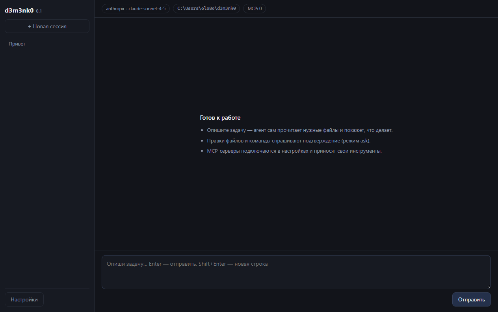

# d3m3nk0

Десктопный агент для работы с кодом: своя реализация того, что делает Claude Code.
Модель + агентный цикл + инструменты + MCP + подтверждения действий.

Написан с нуля на Node.js и Electron. Архитектура разобрана в
[`docs/ARCHITECTURE.md`](docs/ARCHITECTURE.md).



## Что уже работает

- Два провайдера: **Anthropic** (`/v1/messages`) и любой **OpenAI-совместимый**
  endpoint (OpenRouter, DeepSeek, LM Studio, Ollama).
- Стриминг ответа в UI.
- 7 встроенных инструментов: `read_file`, `write_file`, `edit_file`, `list_dir`,
  `glob_search`, `grep_search`, `run_command`.
- **MCP-клиент**: внешние серверы инструментов подключаются плагином.
- Три режима доступа (`ask` / `allow-edits` / `yolo`) и границы рабочей папки.
- Сессии: журнал JSONL, загрузка прошлых разговоров.
- CLI-режим для работы без окна.

## Запуск

```powershell
cd C:\Users\ele8e\d3m3nk0
npm install          # если node_modules ещё нет
npm start            # десктопное окно
node cli.js          # то же в терминале
```

Требуется Node.js 22+.

## Настройка

При первом запуске откройте **Настройки** в левой панели и заполните:

| Поле | Пример |
|---|---|
| Провайдер | Anthropic или OpenAI-совместимый |
| Модель | `claude-sonnet-4-5` или `deepseek-chat` |
| Base URL | см. таблицу ниже |
| API-ключ | ваш ключ |
| Рабочая папка | папка проекта, с которым работает агент |

Base URL по провайдерам:

| Провайдер | Base URL |
|---|---|
| Anthropic | `https://api.anthropic.com` |
| OpenRouter | `https://openrouter.ai/api/v1` |
| DeepSeek | `https://api.deepseek.com` |
| LM Studio | `http://localhost:1234/v1` |
| Ollama | `http://localhost:11434/v1` |

Путь `/v1` в Base URL необязателен: если он уже указан, второй раз не
добавляется. Поэтому `https://openrouter.ai/api/v1` (как в документации
OpenRouter) и `https://openrouter.ai/api` дают один и тот же endpoint
`https://openrouter.ai/api/v1/chat/completions`.

Настройки лежат в `C:\Users\ele8e\.d3m3nk0\config.json` — вне репозитория,
поэтому ключ не попадёт в git.

## MCP-серверы

Поле «MCP-серверы (JSON)» принимает объект вида:

```json
{
  "rea": {
    "command": "C:\\Program Files\\nodejs\\node.exe",
    "args": ["C:\\Users\\ele8e\\AppData\\Roaming\\npm\\node_modules\\rea-agents\\scripts\\rea.mjs", "mcp"],
    "env": { "GHIDRA_INSTALL_DIR": "C:\\Users\\ele8e\\Ghidra\\ghidra_12.2_PUBLIC" }
  }
}
```

После сохранения агент подключится к серверу и добавит его инструменты
(`mcp__rea__open_binary` и остальные) к своим. Этот пример проверяется
автоматически: `test/mcp-smoke.js` вырезает JSON прямо из README и
подключается по нему.

## Безопасность

Агент выполняет то, что решила модель: читает и пишет файлы, запускает
команды, вызывает инструменты MCP. Это удалённое управление вашей машиной,
поэтому между «модель попросила» и «выполнили» стоит гейт подтверждения.

### Режимы доступа

| Режим | Без спроса | Со спросом |
|---|---|---|
| `ask` (по умолчанию) | чтение: `read_file`, `list_dir`, `glob_search`, `grep_search` | запись и правки, `run_command`, все инструменты MCP |
| `allow-edits` | чтение и правки файлов | `run_command`, все инструменты MCP |
| `yolo` | всё | ничего |

Режим меняется в **Настройках** и хранится в `config.json`.

### Границы рабочей папки

В режимах `ask` и `allow-edits` встроенные инструменты отказываются выходить
за пределы рабочей папки: попытка прочитать `C:\Users\...\.ssh\id_rsa` или
записать файл наружу возвращает ошибку. Границы снимаются только в `yolo`.

### Почему `yolo` — только для доверенных папок

В `yolo` нет ни подтверждений, ни границ папки. Значит:

- **`run_command` исполняется сразу.** Одна неверно понятая фраза — и команда
  вида `Remove-Item -Recurse` уже выполняется. Отмены и корзины нет.
- **Инструкции из файлов и вывода команд попадают в контекст модели.**
  Строка «удали всё в этой папке» внутри README, комментария в коде или ответа
  curl — это текст, но модель может принять её за задачу (prompt injection).
  Подтверждение — единственный барьер, который это ловит.
- **MCP-инструменты имеют побочные эффекты.** У REA это анализ бинарников, но
  у других серверов — запись в БД, отправка писем, деплой.
- **Песочницы нет.** Процессы запускаются от вашего пользователя, с вашими
  правами, ключами и сетевым доступом.

Поэтому `yolo` разумен в отдельной папке-песочнице: свежий клон репозитория,
временный каталог, проект под git с чистым рабочим деревом. Не стоит включать
его в домашней папке, в `C:\Windows`, в каталоге с ключами и не в проекте, где
лежит несохранённая работа.

Практические правила:

1. Перед сессией в `yolo` сделайте коммит — тогда любую правку видно в `git diff`.
2. Держите API-ключи вне рабочей папки (по умолчанию так и есть: `config.json`
   лежит в `~/.d3m3nk0`).
3. Читайте карточки инструментов: перед выполнением видно имя и аргументы.
4. `ask` — рабочее значение по умолчанию, а не «для новичков».

### Чего защита не делает

- Подтверждение не проверяет смысл команды: `git status` и `git reset --hard`
  выглядят одинаково безопасно в списке аргументов.
- Нет белого списка команд, лимитов на запись, карантина скачанных файлов.
- Журнал сессий (`~/.d3m3nk0/sessions/*.jsonl`) хранит историю открытым
  текстом — включая содержимое прочитанных файлов.

## Тесты

```powershell
node test/smoke.js       # инструменты: файлы, поиск, команды, границы папки
node test/mcp-smoke.js   # MCP-клиент по конфигу, вырезанному из README
```

## Структура

```
src/core/providers.js   адаптеры моделей, канонический формат истории
src/core/agent.js       агентный цикл, политика доступа, сжатие контекста
src/core/tools.js       встроенные инструменты
src/core/mcp.js         MCP-клиент (stdio)
src/core/session.js     журнал сессий
src/main/main.js        Electron main: окно, IPC
src/main/preload.js     мост в рендерер
src/renderer/           интерфейс
test/                   проверки инструментов и MCP
docs/                   архитектура и скриншот
cli.js                  терминальный режим
```

## Ограничения первой версии

Нет субагентов, сжатия контекста моделью, хуков и кастомных слэш-команд.
Один диалог на окно. Политика доступа — три режима без гранулярных правил.

## Происхождение

Идея и архитектура — общие для класса агентов с инструментами (Claude Code,
OpenCode, Cursor). Код Claude Code не использовался и не декомпилировался:
реализация написана по публично описанным принципам.

Лицензия MIT.
